# Life АКПП — корпоративный сайт автосервиса на 1С-Битрикс

Корпоративный сайт для специализированного автосервиса японских автомобилей в Магадане.
Проект демонстрирует разработку на 1С-Битрикс (D7): кастомные компоненты, шаблоны
компонентов, работу с инфоблоками, включаемыми областями и настройку окружения в Docker.

---

## 📌 Статус и ограничения

Проект разработан на **ознакомительной (триальной) версии 1С-Битрикс** и не предназначен
для публичного развёртывания. Репозиторий содержит только кастомный код (`/local/`) и
каркасы страниц — **без ядра Битрикса и базы данных**.

**Что это значит:**

- Для запуска требуется действующая лицензия 1С-Битрикс и установка ядра.
- Контент (инфоблоки, элементы, пользователи) хранится в БД и не входит в репозиторий.
- Цель репозитория — демонстрация кода и архитектурных решений, а не готовый дистрибутив.

**Как оценить проект без запуска:**

- Скриншоты публичной части и админки — в разделе [«Скриншоты»](#-скриншоты).
- Ключевые решения — в разделе [«Архитектурные решения»](#️-ключевые-архитектурные-решения).
- Код кастомных компонентов — в `/local/components/autoservice/`.

---

## 🎯 Задача и роль

**Задача:** создать сайт услуг с управляемым контентом, чтобы менеджер мог
самостоятельно менять информацию без участия разработчика.

**Моя роль:** полный цикл разработки — от настройки Docker-окружения и структуры
инфоблоков до кастомных компонентов, шаблонов и настройки прав.

---

## 🛠️ Стек

- **CMS:** 1С-Битрикс: Управление сайтом (D7)
- **Языки:** PHP 8.2, JavaScript, HTML5, CSS3
- **Окружение:** Docker (`bitrix/env-docker`: nginx, php-fpm, mysql, redis, memcached)
- **Инструменты:** Git, VS Code

---

---

## 🗃️ Структура данных

Контент разделён по назначению — у каждого типа своя зона ответственности:

| Инфоблок | Тип | Назначение | Ключевые свойства |
|---|---|---|---|
| **Услуги** | `services` | Список услуг с ценами для калькулятора и страниц | `PRICE` (число), `SERVICE_IMG` (файл), `FULL_DESCRIPTION` (HTML) |
| **Марки авто** | `content` | Справочник марок для фильтра и форм | `CARS_LOGO` (файл), `CARS_DESCRIPTION` (HTML) |
| **Шаги работы** | `content` | Блок «Как мы работаем» на главной | `STEP_TEXT` (HTML) |
| **Настройки сайта** | `content` | Контакты, название, соцсети в шапке/футере | `PHONE`, `EMAIL`, `ADDRESS`, `SOCIAL_*` |
| **Баннеры** | `content` | Hero-баннер на главной и «О нас» | `IMAGE` (файл), `TITLE`, `IMAGE_ALT` |

**Почему так:**
- **Услуги — в `services`**, потому что это отдельная бизнес-сущность со своей логикой (цены, страницы, форма заявки).
- **Марки, шаги, настройки, баннеры — в `content`**, потому что это контентные блоки без собственной бизнес-логики.
- **Стандартные поля (`NAME`, `PREVIEW_TEXT`, `DETAIL_PICTURE`)** используются везде, где данные совпадают по смыслу — это упрощает админку и поиск.
- **Свойства** добавляются только для того, чего нет в стандартных полях (цены, логотипы, HTML-описания).

## 🏗️ Ключевые архитектурные решения

### 1. Кастомные компоненты вместо правки ядра

Вся бизнес-логика вынесена в `/local/components/autoservice/` — ядро Битрикса не
тронуто. Это значит, что обновления CMS не сломают проект, а компоненты можно
переиспользовать в других проектах.

Реализованные компоненты: `banner.text`, `about.text`, `calc.form`, `feedback.form`.

2. Централизованные настройки сайта через инфоблок

Контакты, название сайта и ссылки на соцсети в шапке и футере хранятся в отдельном инфоблоке «Настройки сайта» (ID 3). Функция getSiteSettings() в local/php_interface/init.php один раз за запрос вытаскивает все свойства элемента и кеширует их в статической переменной. Это даёт:

Единую точку правки — менеджер меняет телефон или адрес в одном месте, и значения обновляются во всех блоках сайта.

Отсутствие дублирования запросов — статический кеш гарантирует, что инфоблок опрашивается один раз, даже если функция вызывается в header.php и footer.php.

Защиту от пустых значений — если свойство не заполнено, подставляется значение по умолчанию из массива $settings.

3. Калькулятор стоимости ремонта (calc.form)

Компонент autoservice:calc.form — это не просто форма, а мини-калькулятор. В class.php он:

Загружает список услуг из инфоблока и читает их свойство PRICE (числовое значение).

Загружает список марок авто из другого инфоблока.

Подтягивает поля веб-формы, чтобы связать отправку с конкретной формой в Битриксе.

Позволяет менеджеру редактировать цены через админку (свойство PRICE элемента инфоблока), не трогая код калькулятора.

4. Формы, интегрированные с веб-формами Битрикса

В проекте два сценария отправки:

feedback.form — используется на детальных страницах марок и услуг. Компонент сам подгружает поля веб-формы по её ID, список услуг и марок, а также находит ID варианта ответа для чекбокса согласия. На странице марки форма предвыбирает марку, на странице услуги — услугу.

form.result.new с шаблоном callback — вызывается в футере для общего «Заказать звонок». Результаты всех форм сохраняются в стандартных веб-формах Битрикса, доступных в админке (Контент → Веб-формы → Результаты).

5. Динамические заголовки через component_epilog.php

Для детальных страниц марок и услуг заголовок вкладки браузера (<title>) и H1 устанавливаются в component_epilog.php, а не в template.php. Это позволяет корректно работать при включённом кэшировании: template.php кэшируется, а component_epilog.php выполняется на каждом запросе.

---

## 📸 Скриншоты

### Публичная часть

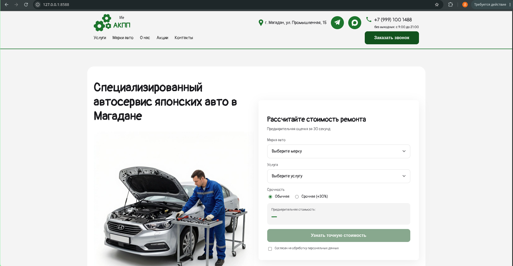
*Главная: баннер и калькулятор стоимости ремонта (кастомный компонент `calc.form`).*

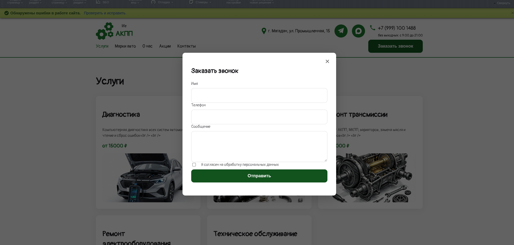

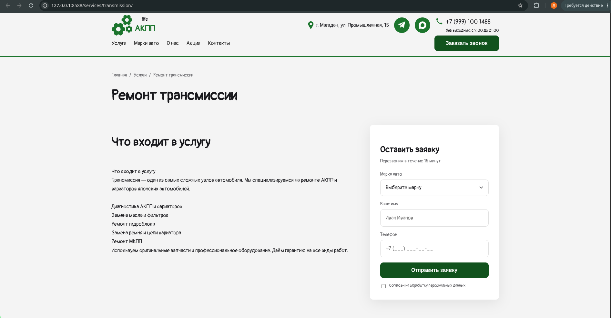
*Карточка услуги: заголовок вкладки формируется динамически через `component_epilog.php`, форма заявки с предвыбранной услугой.*

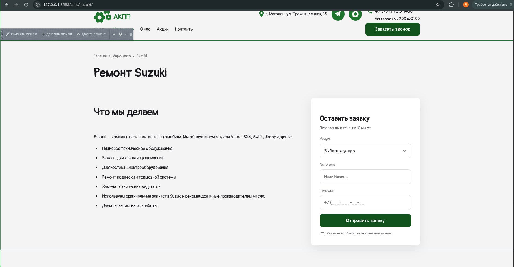
*Страница марки: описание, логотип из свойства типа «Файл», форма с предвыбранной маркой.*

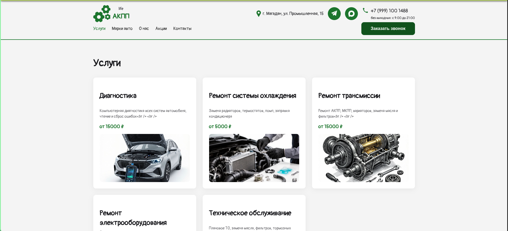
*Список услуг: шаблон `news.list/services`, карточки с ценой и ссылкой.*

### Админка и управление контентом

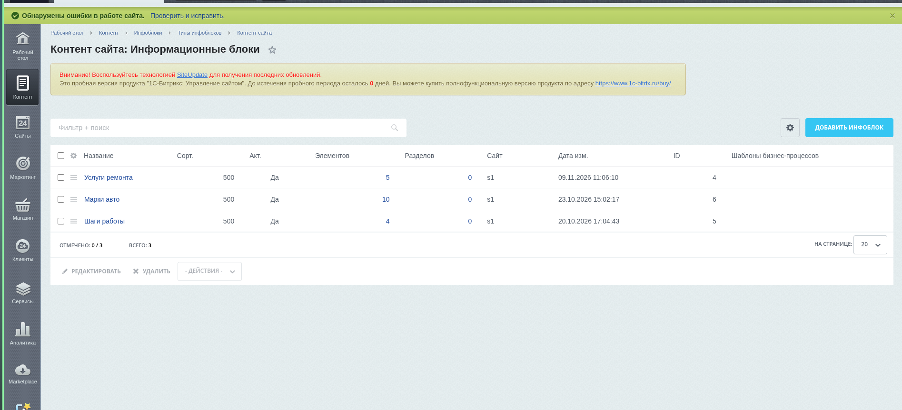 

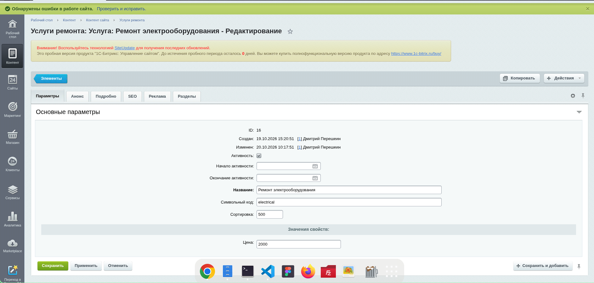 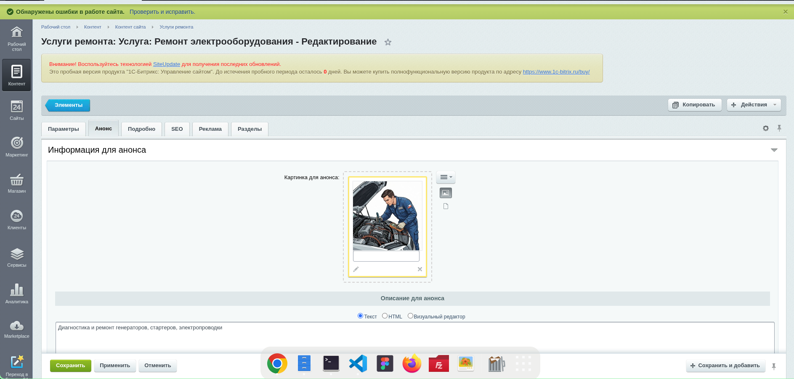 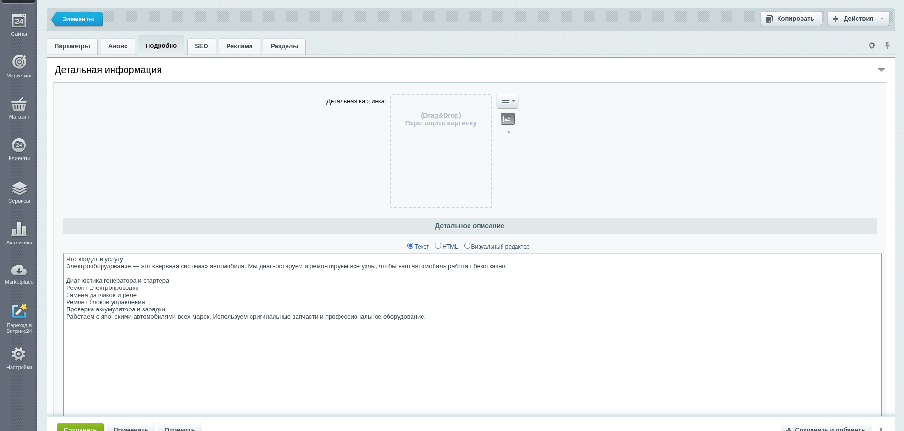
*Свойства инфоблока: строка для названия, «Файл» для логотипа, HTML для описания — тип поля соответствует способу вывода в шаблоне.*

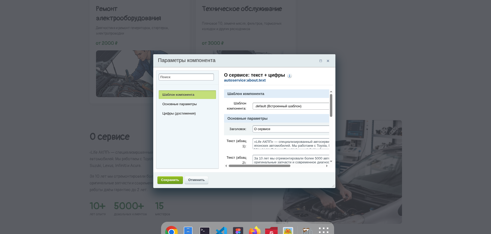 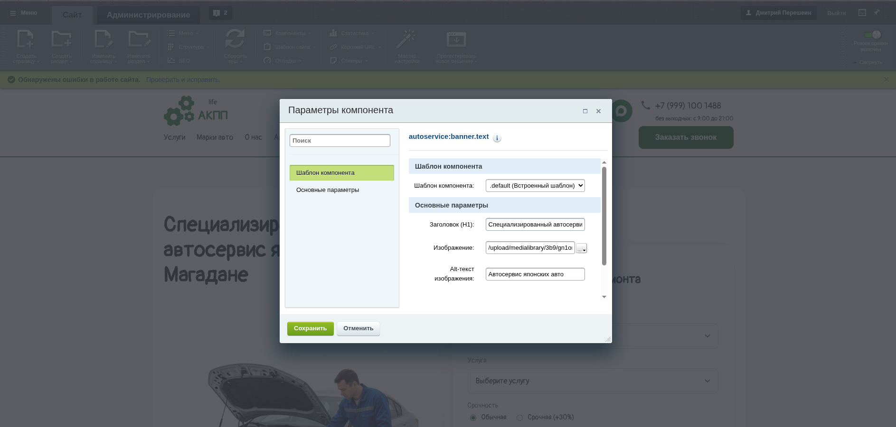 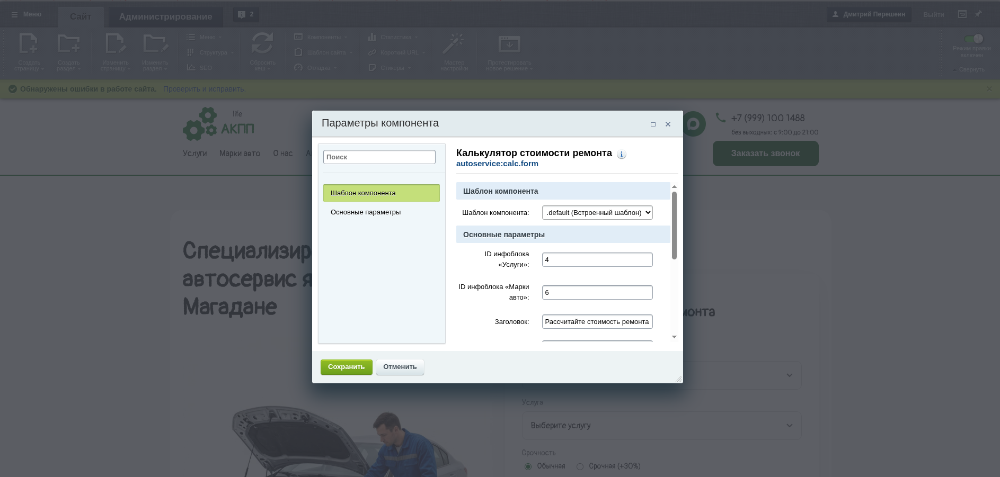 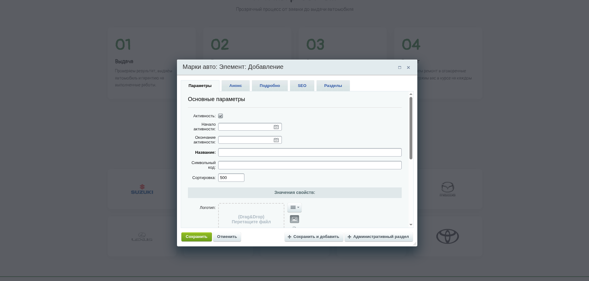 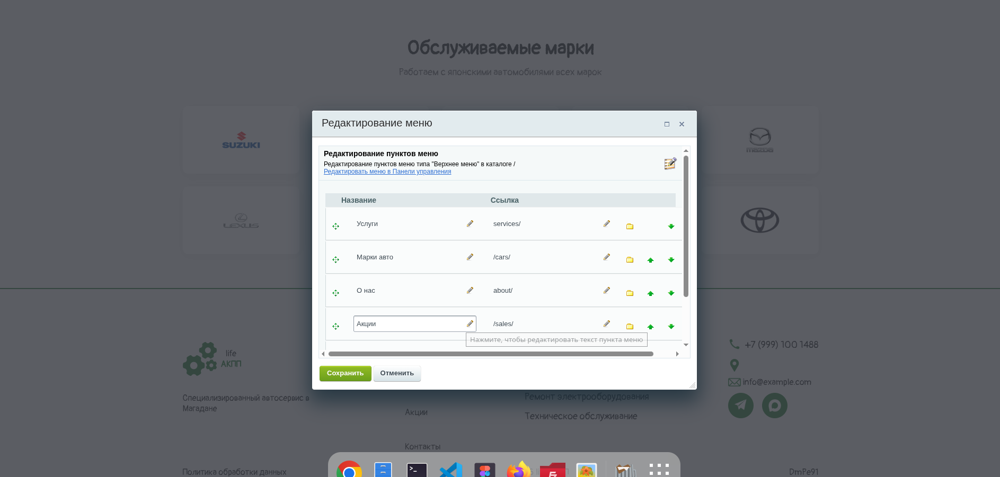 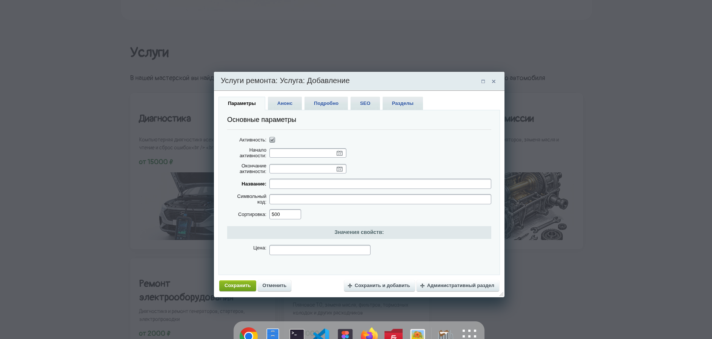 
*Режим правки: включаемые области в шапке и футере редактируются без захода в админку, разметка защищена `MODE => 'text'`.*

